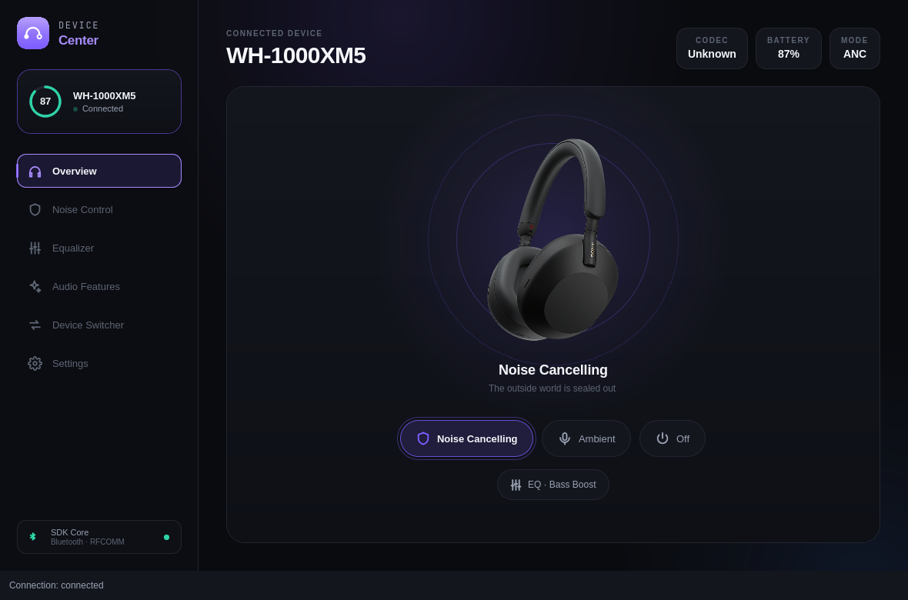
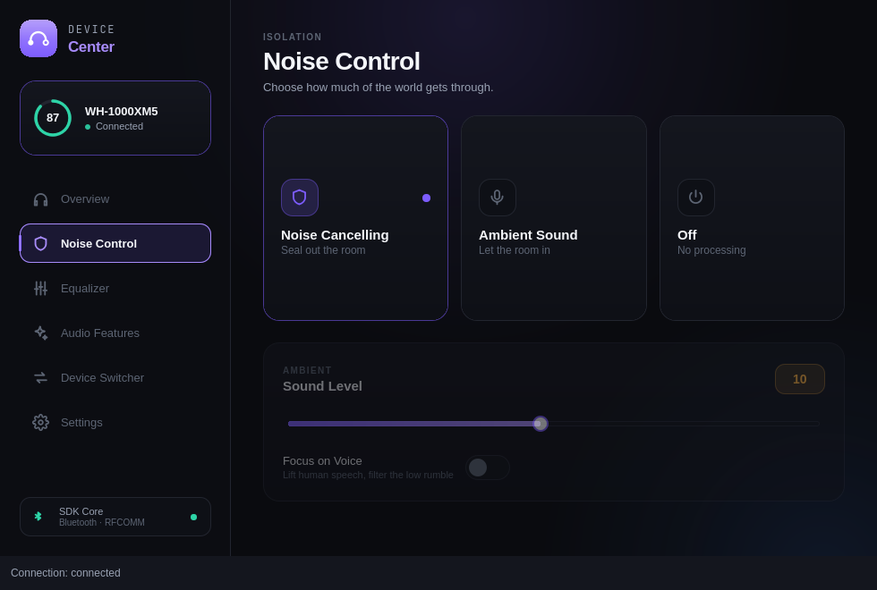

# Omarchy Linux build

This local edition reuses Sony Device Center's MIT-licensed C++ Bluetooth
engine and Qt interface. The layout, artwork, dark surfaces and violet controls
come from the screenshots in the upstream README, not a recreated web mockup.

## Build and install

Required Arch packages: gcc, cmake, ninja, bluez-libs, dbus, qt6-base,
qt6-declarative. Build from the task worktree through the local build queue:
On the configured Pro, CMake is installed in the isolated tool environment at
`~/.cache/sony-device-center-tools/bin/cmake` (with `ctest` alongside it).

```sh
buildq enqueue --wait --name "Sony: configure" -- cmake -S . -B build-linux -G Ninja \
  -DCMAKE_BUILD_TYPE=Release -DSONY_REQUIRE_QT=ON -DSONY_BUILD_LEGACY_CLIENT=OFF \
  -DCMAKE_POLICY_VERSION_MINIMUM=3.5 -DBUILD_TESTING=ON
buildq enqueue --wait --name "Sony: build" -- cmake --build build-linux --parallel 4
buildq enqueue --wait --name "Sony: tests" -- ctest --test-dir build-linux --output-on-failure --parallel 1
bash packaging/linux/install-user.sh
```

The installer creates a user-local app, CLI, desktop entry and an on-demand
systemd user service. It does not use sudo, enable boot startup, alter PipeWire
profiles, replace system Bluetooth packages or update headset firmware.
Open **Sony Device Center** from the app launcher. Its wrapper starts the daemon;
only that daemon owns the Bluetooth control session. The GUI and CLI use its
private local socket, without a network listener.

```sh
sonyctl devices
sonyctl status
sonyctl info
systemctl --user status sony-device-center-local.service
```

Do not run a second direct Bluetooth client while this daemon is active.
Stop it first with `systemctl --user stop sony-device-center-local.service`.

## WH-1000XM4

The XM4 uses protocol V1. This edition preserves the upstream protocol safety
tests and corrects a misleading V2 label in the interface. It also retains the
last confirmed Ambient level and voice-focus choice through ANC/Off replies,
which report level zero; a new device starts with level ten.

The headset must be powered on and paired over Bluetooth. USB is for charging:
[Sony documents that the XM4 cannot operate while charging](https://helpguide.sony.net/mdr/wh1000xm4/v1/en/contents/TP0002752803.html).
When disconnected, readings remain unknown; no demo values are used in the app.

The app controls Sony settings. It does not fix the separate HFP/mSBC/CVSD audio
transport failure previously observed on this host. Keep the webcam microphone
and LDAC playback until an actual headset-microphone test succeeds.

## Visual checks

`build-linux/apps/device-center/sony-ui-preview OUTPUT_DIRECTORY` renders the
six real QML pages when connected to a simulated daemon in an isolated runtime
directory. Those captures are design evidence, not proof of XM4 functionality.
The helper is built only with tests; it is not installed with the app.
It exercises Return-key navigation and captures both 1180×780 and 980×660 layouts.

Hardware verification must record the commit, headset firmware, operating system,
connection mode and setting readback. ACK alone does not establish audible success.

## Verification on Omarchy Pro, 29 October 2026

- Upstream baseline: `0bf98223c1ba402dd6c5136c21e6ab35482e4390`.
- Native build: GCC 16.2.1, Qt 6.12.0, BlueZ 5.87, CMake 4.4.4.
- Full CTest suite: 137/137 passed (buildq 1165), including the new Ambient
  preference regression, worker integration and actual QML startup.
- Final production build: buildq 1170; affected Qt tests: 2/2 passed (1171).
- Final visual helper build: 1172. All successful receipts report matching
  source before/after. An earlier helper build failed on a missing QQuickItem
  include; it was corrected before the successful build.
- Real QML rendered at 1180×780 and 980×660: 12 images, Return-key navigation
  passed for all six pages at both sizes. No QML errors in the render log.
- User-local installation succeeded; the native Wayland window is mapped and
  the private daemon socket responds. The webcam remains the default microphone.
- Hardware control is **not verified**: XM4 is paired but unavailable while
  charging over USB. A connection attempt returned `br-connection-page-timeout`.
  No ANC/Ambient/EQ writes were sent to the physical headset.

These images show the actual application with the isolated **XM5 simulator**,
not live readings from the user's XM4:



